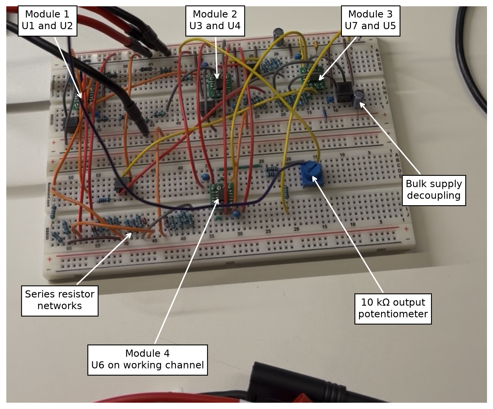
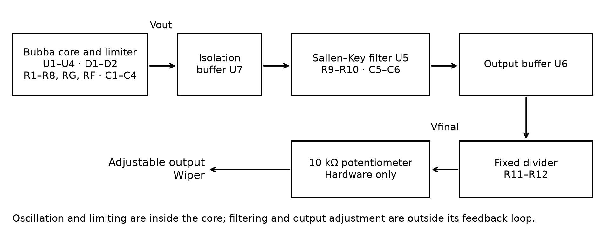

# 10 kHz Bubba sine-wave oscillator

An analog oscillator project by **Andi An**: analytical design, LTspice simulation,
Python-assisted component optimization, breadboard construction, and measurement.

**Current status:** breadboard built and measured. PCB design, fabrication, and
PCB validation are planned; the files in `pcb/` are a starting structure, not a
completed board design.



## Design

A four-stage Bubba oscillator with diode amplitude limiting feeds an isolation
buffer, a resonant second-order Sallen–Key low-pass filter, an output buffer, and
an adjustable divider. The filter targets the dominant third harmonic. Seven
OPA1656 amplifier channels operate from an external ±15 V supply. A 10 kΩ
potentiometer provides output adjustment in the physical prototype.



## Recorded results

| Evaluation | Frequency | Output | Spectral result |
|---|---:|---:|---:|
| Final discrete LTspice optimization | 9,984.352 Hz | 4.949660 Vpp | 90.783 dB SFDR |
| Breadboard, near full output | 10,052.83 Hz | approximately 4.98 Vpp | estimated 88.79 dBc SFDR, 0–100 kHz |
| Oscilloscope waveform captures | approximately 10 kHz | 5.07, 3.82, and 0.800 Vpp | Sine-wave shape and amplitude adjustment |

The near-full-output measurement exceeds the 75 dB design target by 13.79 dB.
The recorded frequency is within the 10 kHz ±1% requirement. Simulated SFDR rose
from 58.252 dB for the optimized unfiltered core to 88.47 dB after filtering;
device-model substitution and discrete optimization subsequently gave 90.783 dB.

These are **breadboard and simulation results**, not PCB performance claims.
The simulation and measurement use different bandwidths, windowing, and output
loads. Low-amplitude analyzer readouts are affected by averaging and the noise
floor. The tolerance study found 46 of 256 timing-component corners outside the
frequency requirement. See [measurement details](docs/measurements.md) and
[recorded simulation results](results/README.md).

## Repository map

| Directory | Contents |
|---|---|
| [`simulation/ltspice/`](simulation/ltspice/) | Final schematic, sweep starting schematic, winning netlist, symbols and device models |
| [`simulation/scripts/`](simulation/scripts/) | Nominal measurement, discrete sweep, coherent analysis, and tolerance scripts |
| [`results/`](results/) | Saved optimization and tolerance records |
| [`evidence/`](evidence/) | 10-second demonstration and captured analyzer readouts |
| [`docs/`](docs/) | Design notes, component values, figures, and archived Word report |
| [`pcb/`](pcb/) | Planned schematic/layout, fabrication, assembly, and validation directories |

## Run the simulation tools

The simulation launchers were developed for **Windows with LTspice installed**.
Their process-control code uses Windows APIs; Linux/Wine execution has not been
validated. This repository can be cloned and edited on Linux, and the saved
results can be inspected without running LTspice.

From the repository root, create a Python environment and install dependencies:

```powershell
python -m venv .venv
.\.venv\Scripts\python.exe -m pip install -r requirements.txt
```

Open `simulation/ltspice/Oscillator_Final.asc` in LTspice for the final drawn
circuit. Keep the model and symbol files in the same directory.

```powershell
# Preview the buildable resistor grid without running simulations
.\.venv\Scripts\python.exe simulation/scripts/Buildable_sweep.py --dry-run

# Run and measure the final schematic once
.\.venv\Scripts\python.exe simulation/scripts/Measure_Oscillator_Final.py

# Run one known candidate through the discrete-sweep pipeline
.\.venv\Scripts\python.exe simulation/scripts/Buildable_sweep.py --check

# Run 256 timing corners plus the separate four gain-resistor corners
.\.venv\Scripts\python.exe simulation/scripts/tolerance_final.py
```

Generated runs go into ignored `runs/` directories. The complete corner sweep
can take a long time. For software assumptions, source-model details, and the
differences between the schematic and sweep netlist, read
[reproducing the simulations](docs/simulation.md).

## Demonstration and report

- [10-second demonstration video](evidence/Oscillator_demo_10_seconds.mp4):
  circuit, manual potentiometer adjustment, and changing sine-wave amplitude.
  The second half is a labeled 2.8× playback of the amplitude sweep.
- [Archived Word report](docs/report/Oscillator_lab_report_performance_complete.docx).
- [Measured spectrum near full output](docs/images/spectrum-full-output.png).

## PCB next steps

The PCB revision will preserve the breadboard as a measured reference. Start in
[`pcb/README.md`](pcb/README.md), then add the chosen EDA project, board revisions,
manufacturing outputs, assembly records, and fresh measurement evidence.

Third-party model notices are retained in their files. See
[third-party notices](THIRD_PARTY_NOTICES.md). No open-source license has been
selected for the project.
