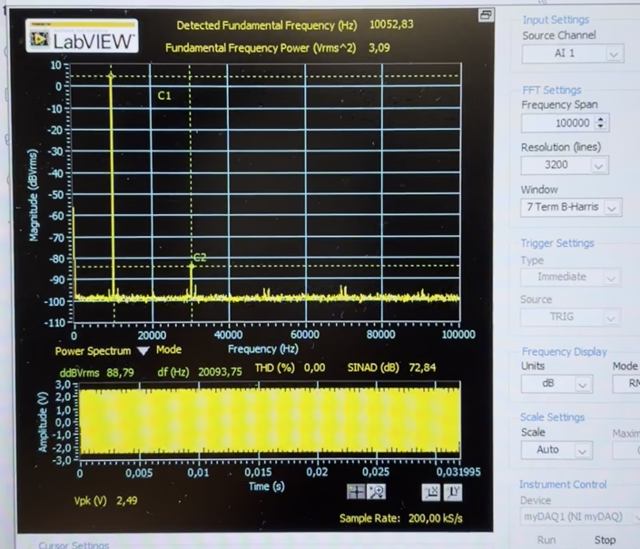

# Breadboard measurement evidence

The final output was measured at the potentiometer wiper using an external
±15 V supply. NI myDAQ / NI ELVISmx provided frequency-domain measurements;
a laboratory oscilloscope provided separate time-domain captures.

Analyzer configuration: ±10 V input range, 0–100 kHz span, 3,200 lines, seven-term
Blackman–Harris window, RMS display, exponential averaging with 20 averages,
200 ksample/s. The report identifies AI 1 for the recorded evidence.

Near full output, displayed Vpk=2.49 V corresponds to approximately 4.98 Vpp for
the sine wave. The recorded fundamental was 10,052.83 Hz and fundamental-to-H3
cursor separation was 88.79 dB. H3 was the largest clearly resolved unwanted
peak in that displayed spectrum, giving an estimated SFDR of 88.79 dBc.

`evidence/captured-analyzer-readouts.csv` transcribes Table P1 of the report.
These are displayed readouts during amplitude adjustment, not independently
settled and calibrated measurements at every amplitude. At lower amplitudes,
averaging history and the analyzer noise floor limit their interpretation.
The near-full-output capture is the principal spectral evidence. A fleeting,
unrecorded observation near 93 dB is not used as the project's headline result.

Time-domain images document 5.07, 3.82 and 0.800 Vpp; they were recorded separately
from the myDAQ spectra, not as paired samples. The maximum output supports
adjustment through 5 Vpp. The near-zero display does not establish an exact zero
residual; SFDR is undefined for an exactly zero signal. Displayed THD=0.00% does
not prove zero harmonic distortion.

The measurements include the acquisition setup's contribution. No independent
calibration isolated analyzer distortion or produced a statistical uncertainty.
The later bench troubleshooting sequence is not part of this archived dataset.

## Media sources

- Spectral figures: captured from IMG_1041 (1).mov.
- Scope figures and demo: captured from IMG_1040 (1).mp4.
- Breadboard figure: based on IMG_1049.PNG with module annotations.
- The 10-second demo retains source seconds 0–5 at normal speed, followed by
  source seconds 12–26 at 2.8× speed. It is muted and the speed change is labeled.

Original long recordings remain outside this repository; the curated evidence
and exact-duration demonstration are included. The Word file is an archived
project report; later manual edits made only in Canvas are not synchronized back
into that file.
