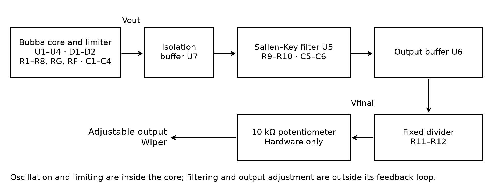
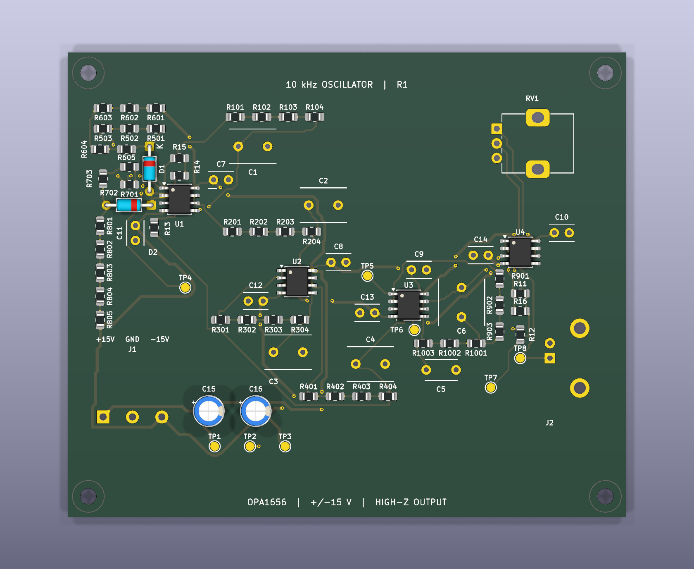
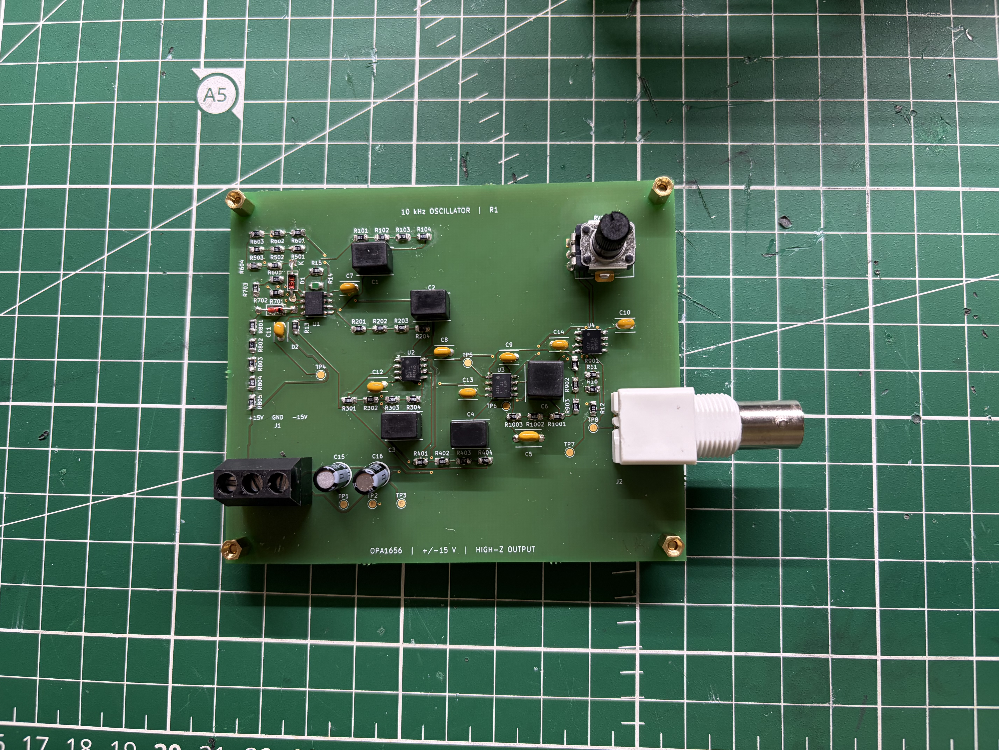
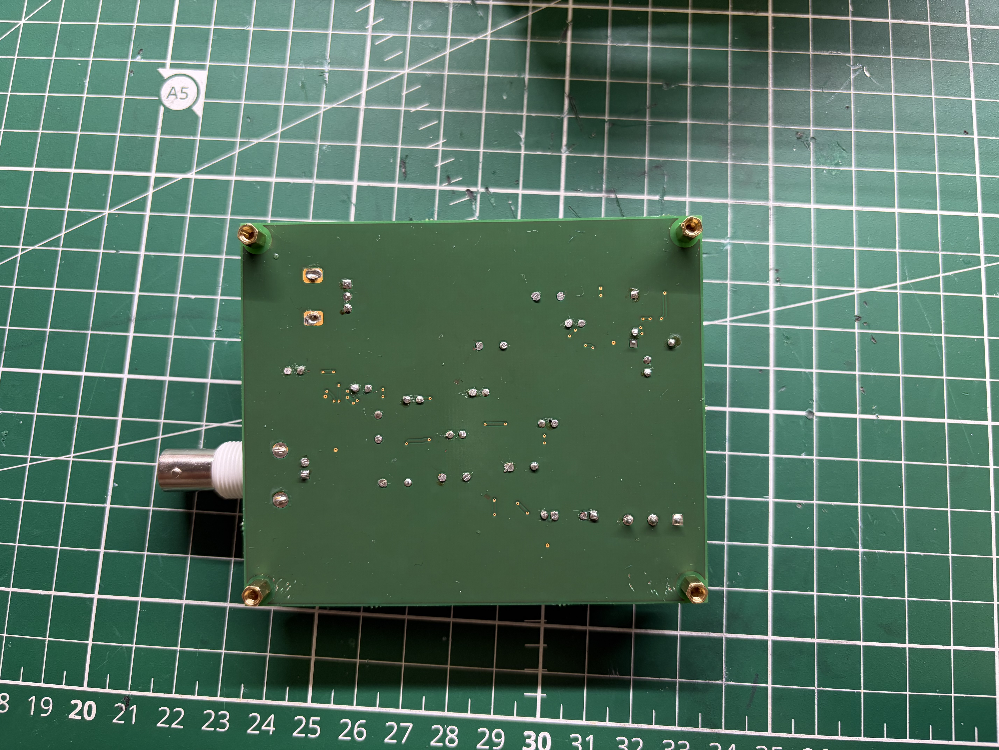
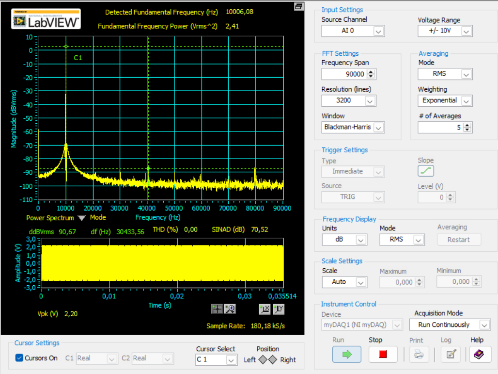
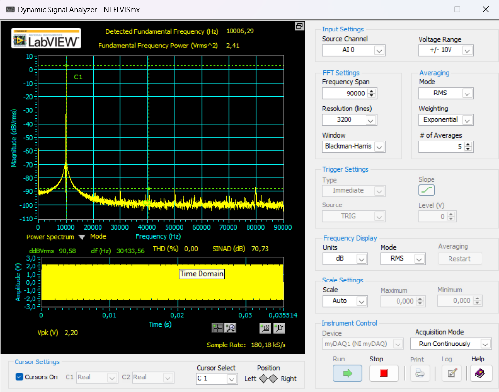

# Design implementation and evaluation of a 10 kHz sine wave oscillator

**Andi An · Personal engineering project · R1 PCB · 22 November 2026**

## Project outcome

This project developed a 10 kHz analog sine-wave source through analytical design, LTspice optimization, breadboard construction and a permanent two-layer PCB. The assembled R1 board operates from external ±15 V rails and provides continuously adjustable output through a BNC connector. Reported bench measurements show approximately 10.006 kHz operation and adjustment from near zero to approximately 4.6 V peak-to-peak into a high-impedance measurement load.

The PCB preserves the working breadboard topology and effective resistor and capacitor values. Its measured frequency is closer to nominal than the breadboard's approximately 10.053 kHz. This comparison establishes nominal frequency error for the tested builds; it does not establish improved temperature stability, long-term drift or production tolerance.

The spectral evidence supports approximately 90 dB separation between the fundamental and a selected component at the 4.40 Vpp test setting. It does not establish calibrated full-band intrinsic SFDR. Supply-related interference, analyzer limitations and uncertainty over maximum-spur selection remain explicit limitations. The project is complete as a documented design, manufactured implementation and functional bench evaluation; precision spectral qualification remains open.

## Reading and reproduction

- [Design and component values](../design.md)
- [Simulation reproduction and model provenance](../simulation.md)
- [Complete hardware measurement record](../../pcb/R1/reports/hardware-measurement-log.md)
- [Native KiCad project](../../pcb/R1/fabrication/review-packages/R1-review-03/source/oscillator.kicad_pro)
- [Independent engineering verification](../../pcb/R1/verification/independent-review.md)
- [Released manufacturing archive](../../pcb/R1/fabrication/releases/R1/Oscillator-PCB-R1-Gerbers.zip)
- [Assembly and measurement instructions](../../pcb/R1/assembly/assembly-and-test.md)
- [Original PCB spectra and photographs](../../evidence/hardware/2026-11-20/README.md)

The original Word report remains a [historical breadboard-stage document](Oscillator_lab_report_performance_complete.docx). This report supersedes its project-status and final-performance conclusions. Older dated review reports describe the engineering state at their issue date and are retained as provenance.

## Objectives and boundaries

The primary implementation objective was to move a functioning oscillator from a breadboard to a mechanically reliable board without discarding the existing optimization work. The requirements included nominal 10 kHz operation, adjustable output approaching 5 Vpp, two-layer manufacture, accessible test points and assembly using the reserved components. The spectral objective was at least 80 dBc SFDR where achievable, with a 75 dBc assessment threshold under a documented valid method.

No topology redesign was authorized or required for the PCB transition. In particular, diode limiting, optimized RC networks, the filter and the fixed output divider were retained. The confirmed 10 kΩ output potentiometer was included in the PCB baseline. A permanent implementation improves mechanical repeatability, but does not by itself guarantee lower distortion or noise.

## Circuit architecture

The oscillator is a four-stage Bubba RC oscillator using buffered phase-shift sections and an inverting gain stage. The four timing networks each use 1,647 Ω and 10 nF. For unloaded identical sections, the starting estimate is f = 1/(2πRC), approximately 9.66 kHz. Loading and finite amplifier behavior mean this relation is only an initial estimate; the recovered circuit and simulated operating point control the final design.

The inverting gain ratio is RF/RG = 48 kΩ / 10 kΩ = 4.8. A symmetric pair of 1N4148 limiter paths controls amplitude through nonlinear feedback. The limiter networks use 130 kΩ and 325 kΩ effective resistances; their ratio of 2.5 must not be confused with the filter quality factor. The limiter introduces harmonics, particularly the third harmonic, which motivated the post-filter optimization.

An isolation buffer feeds a second-order unity-gain Sallen–Key low-pass filter, followed by an output buffer and resistive amplitude control. The filter uses two 1.9 kΩ resistors, 1 nF and 68 nF capacitors. Its ideal natural frequency is approximately 10.16 kHz and Q approximately 4.12. It is deliberately resonant near the fundamental. The earlier informal description of a 30 kHz multiple-feedback filter was incorrect: 30 kHz is the third-harmonic region, not the filter pole frequency.

The fixed divider consists of R11 = 2 kΩ parallel with 100 kΩ, giving 1,960.784 Ω, and R12 = 1 kΩ. A 10 kΩ linear pot connects between VFINAL and ground; the wiper feeds the output BNC. This output is unbuffered after the wiper and is intended for a high-impedance load. A 50 Ω termination is not an equivalent operating condition and substantially loads the divider. Output amplitude and source impedance vary with pot position and external load.

Four OPA1656IDR dual packages provide seven signal-path amplifiers. The unused eighth amplifier is connected as a grounded unity follower. Every package has 100 nF bypassing on each supply rail, with two 10 µF bulk capacitors at the supply input. External power is nominally +15 V, ground and −15 V.

## Component implementation

The board preserves the prototype's physical resistor combinations rather than silently replacing them with nearby preferred values.

| Circuit function | Effective value | Physical implementation |
|---|---:|---|
| Four timing resistors | 1,647 Ω each | 1 kΩ + 330 Ω + 270 Ω + 47 Ω |
| RG | 10 kΩ | One 10 kΩ |
| RF | 48 kΩ | 47 kΩ + 1 kΩ |
| R5 and R7 | 130 kΩ each | 100 kΩ + 20 kΩ + 10 kΩ |
| R6 and R8 | 325 kΩ each | 300 kΩ + 20 kΩ + 4.7 kΩ + 200 Ω + 100 Ω |
| R9 and R10 | 1.9 kΩ each | 1 kΩ + 680 Ω + 220 Ω |
| R11 | 1,960.784 Ω | 2 kΩ parallel with 100 kΩ |
| R12 | 1 kΩ | One 1 kΩ |

The PCB contains 44 fixed 0805 resistors, selected at 0.1% and 25 ppm/°C in the engineering BOM. The [per-component BOM](../../pcb/R1/bom/per-component.csv) supplies every reference and manufacturer part number; the [grouped BOM](../../pcb/R1/bom/grouped-bom.csv) supplies fitted quantities. Those files describe the design selection; they are not independent inspection records for every installed part.

| Component | Selected part | Fitted quantity |
|---|---|---:|
| Dual op-amp | Texas Instruments OPA1656IDR | 4 |
| 10 nF film capacitor | Vishay MKP1837310011 | 4 |
| 1 nF C0G capacitor | KYOCERA AVX SR215A102FARTR1 | 1 |
| 68 nF film capacitor | Vishay MKP1837368011 | 1 |
| 100 nF bypass capacitor | KEMET C315C104K5R5TA | 8 |
| 10 µF 50 V electrolytic | Panasonic EEU-FR1H100 | 2 |
| Limiter diode | onsemi 1N4148 DO-35 | 2 |
| Supply terminal | Molex 39543-0003 | 1 |
| Right-angle BNC | Amphenol RF 031-5431-10RFX | 1 |
| 10 kΩ linear pot | Alps Alpine RK09K1130A5R | 1 |

## Simulation development and evidence

The archived development progressed from an optimized unfiltered core with 58.252 dB modeled SFDR to 88.47 dB after filtering, then to approximately 90.783 dB using real component models and a discrete resistor search. These are different modeled stages and must not be presented as successive physical measurements.

The final saved discrete winner gives 9,984.352 Hz and 4.949660 Vpp before the hardware pot loading is included. The PCB engineering validation added the confirmed pot and a representative 1 MΩ parallel with 20 pF load. This case gives approximately 4.6424 Vpp at maximum, with frequency approximately 9,984.35 Hz and modeled SFDR approximately 90.78 dB. The different amplitudes are explained by circuit loading and variant definitions rather than a change made to force a target result.

The saved analysis uses complete late transient cycles and coherent resampling. Its harmonic calculation considers H2 through H40; the winner's all-bin calculation covers approximately 399.4 kHz. Hardware spectra use different sampling, bandwidth, windowing and loads. Numerical agreement around 90 dB therefore does not independently validate the model's absolute spectral prediction.

The archived 256 timing-component corners at ±1% produced valid records, but 46 fell outside 9.9–10.1 kHz. The frequency range was 9,791.91–10,182.58 Hz. This is a corner study, not a manufacturing yield estimate, and it prevents an unconditional frequency-tolerance claim for all component combinations.

PCB sensitivity screening added bounded, assumed capacitances. Adding 5 pF to each timing node shifted frequency by approximately −4.96 Hz. Adding 5 pF to both internal filter nodes changed amplitude by approximately −0.497%. Smaller accepted cases examined inverting-input and limiter capacitance. These are sensitivity studies, not extracted PCB parasitics or a bound on mutual coupling. A timed-out 5 pF limiter case has no accepted result. No new simulations were run for this final documentation update.

## PCB design and engineering checks

The R1 board is 95 × 79 mm, two-layer FR-4, nominally 1.6 mm thick with 35 µm copper and ENIG. It contains 81 footprints including four M2.5 mounting positions, 591 track segments and 39 through vias. Its broad bottom ground region supports return paths, while local routing and bypass loops were reviewed separately. A plane was not treated as sufficient evidence of good analog grounding.

The layout separates the post-filter/output area from sensitive oscillator nodes, limits additional test access to buffered nodes and supplies, and uses hand-soldering pads for the 0805 resistors and SOIC amplifiers. Eight bare test pads provide access without adding large copper features to high-impedance timing nodes. Through-hole capacitors and connectors were matched to their selected package drawings.

Independent review found and removed a redundant VOUT copper loop before release. The accepted route retains a documented return-path compromise; no extracted coupling analysis proves it optimal. Seven bypass connections measured 3.71–4.93 mm, while U1's negative-rail connection measured 6.32 mm. These geometry records make the actual layout tradeoffs explicit.

| Pre-fabrication check | Archived outcome |
|---|---|
| KiCad ERC | Zero violations |
| Native PCB DRC | Zero violations |
| Unconnected items | Zero |
| Native schematic parity | Zero issues |
| Independent electrical graph | Passed |
| Independent engineering package review | PASS |
| Gerber and drill reconciliation | Passed |

These are design-file checks, not proof of flawless assembly or measured performance. Export inspection reconciled seven Gerber layers, 85 round plated drills, two plated pot slots and four non-plated mounting holes. Original review reports, manifests and hashes remain unchanged in the reviewed snapshot.

The released manufacturing ZIP SHA-256 is `b7150ff62d955080c8e8bda7e1d0696d12e3df7a49b8af16baf8273b0053b478`. The reviewed native board SHA-256 is `a4f358f10eaf822501065362decd702d36b8ac9826cc2c7e55d44460478eb4e2`. Documentation updates do not create a new electrical board revision.

## Manufacture and assembly

Manufacturing was approved by the project owner. Three AISLER boards were received, and one R1 board was assembled and tested. The retained checkout screenshots and historical quotations are not invoices or evidence of an exact final amount paid. Delivery and component-purchase guidance from October is historical and must not be treated as a current quotation.

Assembly included value checks, polarity checks, continuity checks around amplifier pins and rails, flux cleaning and fitting standoffs. During assembly, a resistor intended for R703 was initially installed at R801, then corrected to the specified 300 kΩ at R801. A reversed diode was also reported corrected. These are reported assembly repairs; no corresponding CAD change was required.

The BNC mounting forks initially resisted insertion and were gently compressed by the builder before insertion. The subsequent fit does not establish a footprint defect, nor does it remove the need for ordinary incoming fit inspection on another build. Crowded resistor labels caused placement confusion; the later [clear component map](../../pcb/R1/assembly/drawings/clear-map/R1-clear-component-map.pdf) should be used alongside the reference-value table.

The photographs document the completed build but cannot certify every joint or electrical connection. The [detailed soldering guide](../../pcb/R1/assembly/R1-detailed-soldering-guide.md) preserves the assembly procedure for future builds.

## Power and measurement setup

The Delta Elektronika EST150 uses two floating outputs in series. OUT1 positive is joined to OUT2 negative to form the midpoint. That midpoint connects to PCB GND; OUT1 negative connects to PCB −15 V and OUT2 positive to PCB +15 V. Output 3 is unused. Connections are made with outputs off; each active output is set to 15 V with an initial 60 mA current limit. Correct rail polarity is checked at TP1, TP2 and TP3 before normal testing.

Separate time-domain checks used a Keysight InfiniiVision DSO-X 3014T and direct BNC cable. Direct cable measurements require a 1:1 attenuation setting and a high-impedance input. An earlier 46.2 Vpp reading was a scaling error subsequently corrected to 4.62 Vpp.

For the final spectral experiment the Keysight was disconnected. The PCB BNC center connected to myDAQ AI0+, the shield to AI0− and a short jumper connected AI0− to AGND. The laptop ran on battery. This reference connection addressed a floating-input problem; it is not a general instruction to add duplicate grounds in every instrument setup. The PCB remained powered by the external Delta supply, not the myDAQ power outputs.

The builder confirmed ten minutes of warm-up. The final captures show NI ELVISmx Dynamic Signal Analyzer with AI0, ±10 V range, a 90,000 Hz span, 3,200 lines, Blackman–Harris window and RMS exponential averaging with five averages. The actual displayed sampling rate is 180.18 kS/s. Earlier proposed settings of 200 kS/s must not be substituted for this recorded rate. The software version and calibration status were not recorded.

## Functional hardware results

| Quantity | Reported result | Interpretation |
|---|---|---|
| Positive rail | +15.0146 V DC | DMM reading relative to TP2 |
| Negative rail | −15.0292 V DC | DMM reading relative to TP2 |
| Rail currents | Approximately 30 mA each | Coarse supply display |
| Initial PCB scope frequency | 10.005 kHz | Separate from final FFT captures |
| Observed maximum output | Approximately 4.58–4.62 Vpp | Separate scope observations |
| Final FFT capture output | 2.20 Vpk, calculated 4.40 Vpp | Same displayed amplitude in three captures |
| Minimum output | Approximately zero | No quantified residual floor |
| DC offset | Approximately zero on DMM | Exact value and fluctuation not recorded |
| Startup | Visually rapid | No timed startup or ten-cycle record |

An earlier scope cycle-average result near −58 mV differs from the qualitative DMM observation. Instrument offset, acquisition conditions and actual circuit offset were not separated; the report does not replace this discrepancy with a fabricated exact zero.

The observed maximum is below 5.00 Vpp; the implementation objective was approximately 5 Vpp rather than a separately established exact 5.00 Vpp acceptance limit. It is consistent in scale with the pot-loaded nominal model. Values were not changed merely to force a higher amplitude. The output remains intended for high-impedance measurement or use.

## Amplitude sweep and breadboard comparison

The builder supplied the following PCB readings. Vpp is calculated as twice displayed Vpk and is not an independent amplitude measurement. The spectral column is a reported estimate; the accompanying three captures further constrain how it may be interpreted.

| Vpk V | Calculated Vpp V | PCB frequency Hz | PCB reported separation dB | Breadboard separation dB at matching amplitude |
|---:|---:|---:|---:|---:|
| 2.20 | 4.40 | 10006.22 | 91.0 | 91.08 |
| 1.94 | 3.88 | 10006.20 | 85.3 | 89.93 |
| 1.76 | 3.52 | 10006.19 | 82.0 | 88.06 |
| 1.44 | 2.88 | 10006.26 | 79.0 | 89.62 |
| 0.87 | 1.74 | 10006.28 | 74.5 | 89.01 |
| 0.46 | 0.92 | 10006.38 | 72.8 | 86.72 |
| 0.25 | 0.50 | 10006.32 | 70.5 | 82.70 |

At matching 4.40 Vpp, the breadboard frequency was 10,052.85 Hz and the PCB sweep frequency 10,006.22 Hz. Errors from 10 kHz were +0.5285% and +0.0622%, respectively. The PCB reading is 46.63 Hz closer to nominal. Timing capacitor/resistor differences, parasitics and measurement differences are possible contributors; this dataset does not isolate the cause.

The PCB sweep frequencies span 0.19 Hz across output settings. These are not readings at defined elapsed times and must not be represented as a stability test. At lower amplitudes the reported PCB spectral separation is smaller than the breadboard's. Different spur selection, acquisition conditions, supply interference and analyzer noise can affect these comparisons; the difference cannot be attributed solely to PCB implementation.

Machine-readable transcriptions are provided in [the hardware results directory](../../results/hardware/README.md). The complete nine-row breadboard table remains available separately from the matched-amplitude comparison.

## Repeated spectral captures

| Capture | Frequency Hz | Displayed Vpk V | Cursor difference dB | Displayed SINAD dB |
|---|---:|---:|---:|---:|
| 1 | 10006.08 | 2.20 | 90.67 | 70.52 |
| 2 | 10006.27 | 2.20 | 89.70 | 70.78 |
| 3 | 10006.29 | 2.20 | 90.58 | 70.73 |

The arithmetic mean cursor difference is 90.32 dB, with a 0.97 dB observed range. Capture spacing and averaging-history independence are unknown, so this range is not a calibrated uncertainty. The displayed THD of 0.00% is rounded and does not mean distortion is zero. SINAD includes noise and distortion and is not the same quantity as SFDR.

The displayed cursor frequency separation is 30,433.56 Hz; this is the difference between cursors, not the absolute spur frequency. The selected component is near 40.4 kHz, with the other cursor near the fundamental. Other features, including near 80 kHz, must be compared before this difference can be called SFDR. Thus the strongest defensible reported quantity is selected-component cursor separation.

SFDR is the fundamental-to-largest-other-discrete-tone ratio within a stated band, including non-harmonic tones. A valid evaluation excludes DC and defines the fundamental's window main lobe rather than discarding arbitrary nearby frequencies. A screenshot cursor difference does not establish that every other tone was searched or that the main-lobe amplitudes were measured consistently.

## Interference investigation and measurement limits

A feature near the 100 kHz edge of an earlier 200 kS/s acquisition persisted with the PCB supply outputs off while the Delta main switch remained on. It disappeared when the supply main switch was turned off. Shorting the myDAQ inputs to their reference removed the prominent feature. Replacing power leads did not reliably solve it. These observations support a supply-associated interference path but do not establish its true frequency, exact coupling path or whether the displayed feature is aliased.

A non-harmonic feature near 19 kHz was also reported. A real output tone at that frequency would count in SFDR; not being a harmonic is not a reason to omit it. No powered-off subtraction was applied when transcribing or comparing the supplied readings. Background subtraction was not recommended because phase and amplitude can change with the circuit's operating state.

NI specifies a maximum myDAQ analog-input rate of 200 kS/s and no analog-input anti-alias filter. At the final displayed 180.18 kS/s, Nyquist is approximately 90.09 kHz, leaving the 90 kHz span edge extremely close to the sampling limit. Restricting a plot to 90 kHz neither proves the absence of higher-frequency input energy nor prevents that energy from aliasing into the plotted band. The proposed 100 Hz–90 kHz evaluation is therefore a provisional reporting band, not a metrologically qualified passband.

No raw waveform files, full spectral exports or clean-reference distortion qualification were supplied for this final dataset. An intrinsic SFDR acceptance claim at 75 or 80 dBc is consequently not established. This limitation applies despite cursor separations numerically exceeding those targets.

## Assessment and future work

| Objective | Outcome |
|---|---|
| Preserve recovered topology and values | Implemented and independently checked in CAD |
| Produce a permanent two-layer PCB | Manufactured, assembled and photographed |
| Demonstrate nominal 10 kHz operation | Approximately 10.006 kHz reported |
| Adjustable output approaching 5 Vpp | Demonstrated near zero to approximately 4.6 Vpp; exact 5 Vpp not established |
| Improve nominal frequency error | Observed on this PCB versus this breadboard |
| Improve drift or temperature stability | Not established |
| Verify intrinsic SFDR ≥75 dBc or ≥80 dBc | Not established by the available measurement method |

For a stronger spectral result, use a qualified wideband low-distortion analyzer or digitizer with suitable anti-alias protection and characterize its residual at the actual 10 kHz input level. Define the evaluation band and carrier exclusion, record the largest spur's absolute frequency and level, and preserve raw data or complete spectral exports. A laboratory audio analyzer can simplify this work, but does not automatically remove interference genuinely present at the board output.

Timed warm-up measurements, repeated power-cycle startup records, numerical DC-offset bounds, load sensitivity and ambient-temperature records would extend the performance characterization. These are future tests, not undocumented successes. No further circuit changes are necessary to describe the completed implementation honestly.

## References and evidence provenance

1. [NI myDAQ specifications](https://download.ni.com/support/manuals/373061g.pdf): analog-input sampling and filtering limits.
2. [Texas Instruments OPA1656](https://www.ti.com/product/OPA1656): amplifier datasheet and model resources. The retained model is identified in the simulation provenance records.
3. [Recorded simulation results](../../results/README.md): saved discrete optimization and corner studies.
4. [Independent R1 review](../../pcb/R1/verification/independent-review.md): original circuit graph, layout, mechanical and fabrication checks dated October 2026.
5. [Hardware measurement log](../../pcb/R1/reports/hardware-measurement-log.md): builder-reported readings and interpretation updates recorded November 2026.
6. [Original November evidence](../../evidence/hardware/2026-11-20/README.md): unchanged screenshots, table image and component-side/solder-side photographs.

Displayed digits are retained for traceability, not as a claim of corresponding measurement accuracy. Simulation results, builder-reported hardware readings, screenshot readouts and engineering interpretations are identified separately throughout this report.
