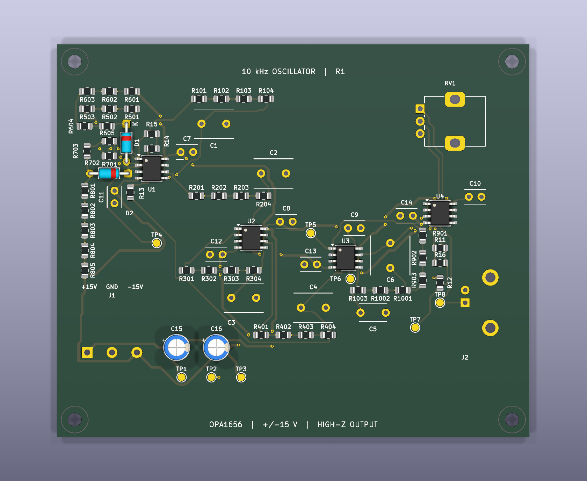

# Oscillator PCB — reviewed R1

22 October 2026. Engineering Gates A–D PASS; user fabrication release and purchase approval pending. No PCB hardware has been fabricated, assembled or tested.

- [Complete engineering ZIP](R1/deliverables/Oscillator-PCB-R1-Engineering-Review.zip)
- [Portable KiCad 9 project](R1/fabrication/review-packages/R1-review-03/source/oscillator.kicad_pro)
- [Exact Gerber/drill ZIP](R1/fabrication/review-packages/R1-review-03/R1-review-03-gerbers-UNRELEASED.zip)
- [Engineering summary](R1/reports/final-engineering-summary.md)
- [Independent verification](R1/verification/independent-review.md)
- [BOM and quantities still to purchase](R1/bom/draft_bom.csv)
- [Assembly and measurement procedure](R1/assembly/assembly-and-test.md)
- [Ordering specifications](R1/fabrication/ordering-guidance.md)

95 × 79 mm; 2 layers; nominal 1.6 mm FR-4; 1 oz copper; ENIG. ERC, DRC, unconnected and schematic parity counts are zero. The exact approved Alps RK09K1130A5R is used. Four dual OPA1656 packages, 44 physical fixed resistors and the original effective R/C values preserve the reference circuit.

R1-review-03 is the only current fabrication candidate. Earlier review snapshots and routing candidates in R1 are retained engineering history, not manufacturing inputs. Upload only the specific Gerber/drill ZIP after user release; do not upload the complete documentation ZIP to a fabrication service.

The R1 directory is a byte-preserved snapshot of engineering workspace commit 3210cab. Its delivery manifest and native-file hashes remain valid. Large simulator waveforms, installed dependencies and machine-local CAD sessions are intentionally excluded. Historical placeholders in the sibling design/fabrication/assembly/validation folders are superseded by R1.

Incoming fit checks and measured hardware validation remain necessary. The 3D preview omits some through-hole part bodies and is not an enclosure-fit model. No delivery date or physical SFDR is guaranteed.
